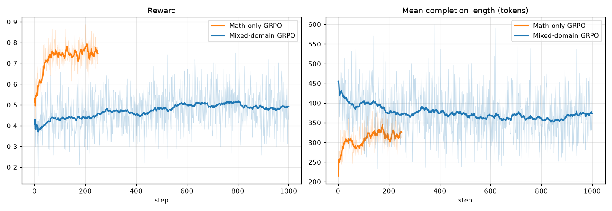

# tiny-aya-reason-vr

Reinforcement learning from **verifiable rewards** for [CohereLabs/tiny-aya-global](https://huggingface.co/CohereLabs/tiny-aya-global). The goal is better step-by-step reasoning on tasks whose answers can be checked automatically: maths (including multilingual maths), financial calculations, code and logic.

The pipeline uses **CuratorKIT** (data curation), **AlignTune** (GRPO/DAPO and SFT, TRL backend) and **AuditKIT** (evaluation). The released model is on the Hub: [abhyudayhari/tiny-aya-reason-vr](https://huggingface.co/abhyudayhari/tiny-aya-reason-vr).

## Results

These are the eval numbers from the old runs. All scores are accuracy (%).
- **Stage 1** is the math-only GRPO model.
- **Stage 2** is the mixed-domain GRPO run, evaluated at steps 400 and 1000.
- The released model, **tiny-aya-reason-vr**, is stage 2 at step 1000.

| Area | Benchmark | tiny-aya-global | Stage 1 (math) | Stage 2 step 400 | **tiny-aya-reason-vr** | Δ vs base |
|---|---|---|---|---|---|---|
| Math | GSM8K | 72.55 | 77.48 | 79.30 | 78.24 | +5.69 |
| Math | MATH-500 | 28.20 | 29.00 | 31.60 | **33.40** | +5.20 |
| Math | SVAMP | 78.33 | 85.00 | – | 83.33 | +5.00 |
| Math | ASDiv | 82.69 | 84.22 | – | **85.14** | +2.45 |
| Math | GSM-Hard | 26.76 | 31.08 | – | 30.40 | +3.64 |
| Math | GSM-Plus | 55.95 | 62.71 | – | **64.24** | +8.29 |
| Math | Minerva Math | 10.29 | 11.76 | – | **12.13** | +1.84 |
| Math | OlympiadBench | 7.40 | 10.15 | – | 8.61 | +1.21 |
| Math | AMC 2023 (40 problems) | 2.50 | 17.50 | – | 10.00 | +7.50 |
| Math | AIME 2024 / 2025 | 0.00 | 0.00 | – | 0.00 | 0.00 |
| Multilingual | MGSM (10 languages) | 58.44 | 66.76 | 65.84 | 66.44 | +8.00 |
| Multilingual | GSM8K Indic (20 variants) | 31.38 | 34.91 | – | **35.62** | +4.24 |
| Finance | FinQA | 40.63 | 42.98 | 46.82 | **49.00** | +8.37 |
| Finance | IndicFin | 16.67 | 16.67 | 21.33 | **23.33** | +6.66 |
| Logic | BBH logic (8 tasks) | 48.30 | 57.80 | 58.30 | 57.95 | +9.65 |
| Logic | Knights & Knaves | 24.00 | 22.00 | 26.00 | **30.00** | +6.00 |
| Code | HumanEval | 56.10 | 57.93 | 58.54 | 57.32 | +1.22 |
| Code | MBPP | 54.09 | 53.31 | 55.25 | **56.81** | +2.72 |

Bold marks the rows where the released model has the best score. "–" means that benchmark wasn't run at step 400.

The released model beats the base on 17 of 19 benchmarks; the other two are AIME 2024 and 2025, where every model scores 0. It beats the stage-1 model on 11 of 19.

### Files from the old runs (`old_runs/`)

| Path | Contents |
|---|---|
| `comparison.csv` | the table above |
| `breakdown.csv` | per-language (MGSM, GSM8K Indic), per-task (BBH) and per-level (MATH-500) results |
| `evals/<model>[-extra\|-extra2\|-indic\|-reason]/` | `summary.json` / `*_summary.json`, plus every model output with its extracted answer and whether it was correct (`<benchmark>.jsonl`, gzipped if large) |
| `training/` | reward and metric curves for both stages: `stage1_math.png`, `stage2_mixed.png` and `stage1_vs_stage2.png` |
| | the full training logs (`*_trainer_state.json`) and the stage-2 reward per 100 steps |

Stage-2 training reward rose from 0.42 in the first 100 steps to about 0.50, and was flat after about step 700. In `stage2_mixed.png`, the dashed line at step 611 marks where training was interrupted and resumed from checkpoint 600.



## Method

1. **Data** (`scripts/data/`). These scripts:
   - Download the eval sets and candidate RL sources, then normalise each source into `data/pool/<source>.jsonl`, with its own verifier.
   - Drop any training prompt that shares a 13-word n-gram with any eval set.
2. **Stage 1: math-only GRPO.**
   - Uses GSM8K and MATH train prompts.
   - The base model samples 8 answers per prompt, and only prompts it gets right 1–7 times are kept.
   - Trains for 250 steps, then merges the LoRA weights.
3. **Mixed data.** The stage-1 model samples 8 answers for every candidate prompt, and `make_mix.py` keeps the *learnable* ones (0 < correct < 8). The sources by domain:

   | Domain | Sources |
   |---|---|
   | Maths | DeepScaleR, DAPO-17k |
   | Multilingual maths | GSM8K translations (Hindi, French, German, Swahili) |
   | Finance | IndicFin, FinQA, TAT-QA |
   | Logic | Knights & Knaves, FLD |
   | Code | MBPP, TACO, KodCode |

4. **Stage 2: mixed-domain GRPO.**
   - 1,200-step learning-rate schedule.
   - The released model is checkpoint 1000, merged.
5. **Rewards** (`scripts/rewards.py`). Every reward is 1 for a correct answer and 0 otherwise:
   - **Maths:** math-verify on the last `\boxed{}` answer.
   - **Finance:** numeric match within a tolerance. Percent and decimal forms count as the same answer, and `INSUFFICIENT` is accepted when the question lacks the information.
   - **Logic:** every knight or knave assignment must be correct, or the answer must exactly match a label.
   - **Code:** the code runs in a sandboxed subprocess against stdin/stdout, assert, pytest or function-call tests. Limits: 2 GB memory, per-test timeouts, and the whole process group is killed on timeout.
6. **SFT** (optional; the released model doesn't use it). CuratorKIT curation of OpenMathInstruct-2 and mCoT-MATH: schema and length gates, exact and MinHash dedup, and text cleaning. Then AlignTune SFT.

### GRPO settings

| | Stage 1 (math) | Stage 2 (mixed) |
|---|---|---|
| LoRA | r 64, alpha 128, all projections | same |
| Loss | DAPO, β 0, ε 0.2 / 0.28 | same |
| Generations per prompt | 8, temperature 1.0 | 8, temperature 1.0 |
| Max prompt / completion | 768 / 1536 tokens | 1536 / 2048 tokens |
| Learning rate | 2e-5 | 1e-5 |
| Steps | 250 | 1000 (of a 1,200-step schedule) |
| Per-device batch / grad accumulation | 4 / 8 | 4 / 4 |

## Running on RunPod

### 1. Create the pod

| Setting | Recommendation |
|---|---|
| GPUs | **8× H100 80GB** (SXM) for the full pipeline. The run scripts use every GPU they see, and evals and probing spread one job per GPU. Evals alone run on a single GPU. |
| Template | any RunPod PyTorch / CUDA 12.x template. The scripts install their own PyTorch, vLLM and AlignTune into separate environments. |
| Storage | a **network volume of at least 300 GB** mounted at `/workspace`. Data, models, checkpoints, envs and the HF cache all live there, so stopping the pod loses nothing. |
| Environment variable | `HF_TOKEN`, ideally as a RunPod secret: `HF_TOKEN={{ RUNPOD_SECRET_HF_TOKEN }}`. tiny-aya-global is gated, so accept its licence on the Hub first. |

### 2. Set up (once per volume)

```bash
cd /workspace
git clone https://github.com/abhyudayhari/tiny-aya-reason-vr.git
cd tiny-aya-reason-vr
bash runpod/setup.sh          # tmux + uv, two venvs in /workspace/venvs, HF login, GPU check
```

If the pod is recreated, run `runpod/setup.sh` again. It only reinstalls the system tools; the venvs on the volume are reused.

### 3. Run

Start long steps with `runpod/bg.sh`, so they keep running if you close the terminal:

```bash
bash runpod/bg.sh all run/pipeline.sh      # everything, end to end
tail -f logs/all.log                       # or: tmux attach -t all
```

Or run step by step:

| Step | Command | Output |
|---|---|---|
| Data | `run/01_data.sh` | eval sets and the RL source pool in `data/` (CPU and network) |
| Base model | `run/02_base.sh` | `models/tiny-aya-global-eos3` (base weights, with stop on end-of-turn or EOS) |
| Stage 1 | `run/03_grpo_math.sh` | `runs/grpo-math-merged` |
| Mix | `run/04_build_mix.sh` | `data/rl_mix.jsonl` |
| Stage 2 | `run/05_grpo_mix.sh` | `runs/grpo-mix-merged` (from checkpoint 1000; set `CKPT=` to merge another) |
| Evals | `run/eval_all.sh MODEL TAG` | `results/TAG*/`, with per-benchmark summaries and every model output |

- **Resume stage 2** after an interruption: `run/05_grpo_mix.sh --resume runs/grpo-mix/checkpoint-N`. Checkpoints are saved every 100 steps.
- **Evaluate the released model** without training:

  ```bash
  run/01_data.sh && run/eval_all.sh abhyudayhari/tiny-aya-reason-vr reason-vr
  ```
- **Optional SFT:** `run/sft_data.sh`, then `run/sft.sh data/sft_mix_messages.jsonl runs/sft`.
- **Fewer GPUs:** set `NUM_GPUS` to override the detected GPU count.
- **Another volume path:** set `WORKSPACE` if the volume isn't at `/workspace`.

## Layout

| Path | Contents |
|---|---|
| `scripts/train_grpo.py`, `train_sft.py` | AlignTune training entry points |
| `scripts/rewards.py` | verifiers for every domain |
| `scripts/probe_pool.py`, `make_mix.py`, `filter_rl.py` | pass-rate probing and learnable-prompt selection |
| `scripts/eval_math.py`, `eval_reason.py`, `eval_indicfin.py` | evals, built on vLLM and AuditKIT |
| `scripts/merge_lora.py` | merges a LoRA adapter into its base |
| `scripts/data/` | download, normalise and decontaminate the data; build the base model |
| `configs/curate_sft.yaml` | CuratorKIT pipeline |
| `run/` | pipeline steps |
| `runpod/` | pod setup and the detached runner |
| `old_runs/` | eval results and training curves from the old runs |
| `tests/` | reward checks: gold solutions must pass, and hung or forking code must time out |

## Licence notes

- tiny-aya-global and its derivatives are **CC-BY-NC 4.0**, and use must follow [Cohere Labs' Acceptable Use Policy](https://docs.cohere.com/docs/c4ai-acceptable-use-policy).
- The training sources keep their own licences. In particular, **KodCode is CC-BY-NC**.
